## Ejercicio 5: Movimiento a marcadores

Para este ejercicio se pedia que tomando tres marcadores como referencia uno para cada objeto (cubo, cilindro y esféra), utilizando para ello uns GameObjects vacíos donde su posición es la referencia hacia donde se deben dirigir los objetos en cuestión.

Se utilizó para llevarlo a cabo un Vector3 publico llamado desplazamiento el cual dirigía a cada uno de los objetos desplazandolo la cantidad de posiciones que el vcector indíque y una función `Input.GetAxis("Jump")` la cual se encargaba de detectar si se presionaba el espacio en el teclado para mover el objeto esas posiciones.

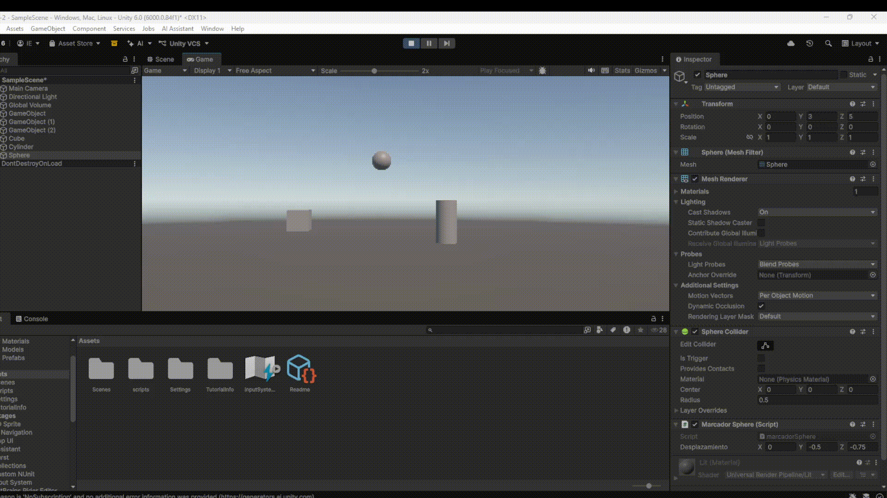

## Ejercicio 6: Campo de velocidad

En este ejercicio se nos pidió añadir un campo `speed` el cual podría ser modificable desde la interfaz de Unity con este campo se podría modificar la velocidad con la que el objeto se movía.

Además se deberiían incluir funciones como `Input.GetAxis("Horizontal")` y `Input.GetAxis("Vertical")` que darián valor de -1 o 1 dependiendo de si se tocaban las teclas de izquierda, derecha, arriba o abajo del teclado. Y foinalmente añadiendo la función `Input.GetKey(KeyCode.RightArrow)` para detectar en ese momento si se tocaba la tecla hacia arriba y lo mismo con las otras tres para mostrar por consola a continuación el resultado de como sería el recorrido que se utilizaría hacia ese lugar en relación a la velocidad señalada.

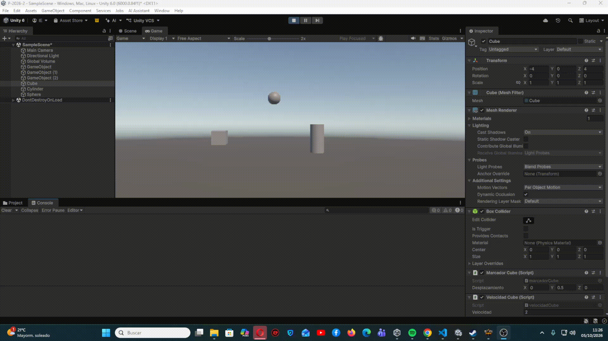

## Ejercicio 7: Mapeo del disparo

En este ejercicio se solicitaba mapear una opción de disparo. Para ello nos situamos en este apartado de nuestra interfaz Unity `Edit → Project Settings → Input Manager → Axes` y colocado ahí cambiarías el botón de activación de Fire 1 a la H y opcional cambiar su nombre a `Disparo`.

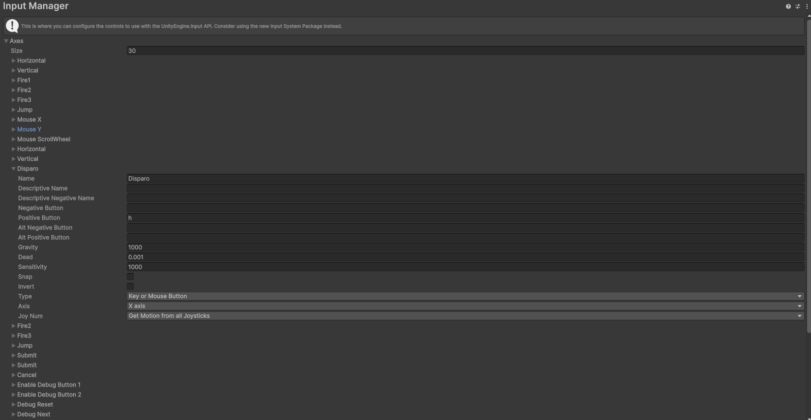

## Ejercico 8: Traslade Cube

En este ejercicio se pide experimentar con un script donde teniendo un cubo con un Vector3 de dirección y su velocidad se probasen diferentes cantidades en sus valores para valorar resultados. Este sería el movimiento normal del script.

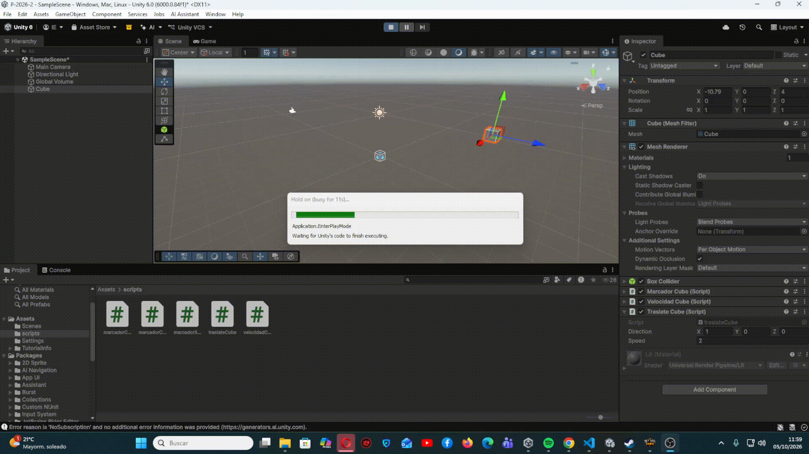

### Duplicado el valor de dirección

En este resultado se ve como el cubo avanza el doble de rápido.

### Duplicado el valor de la velocidad

El resultado es igual al apartado aterior.

### Velocidad menor a 1

Aquí al revés de las dos opciones anteriores el cubo se mueve más despacio,

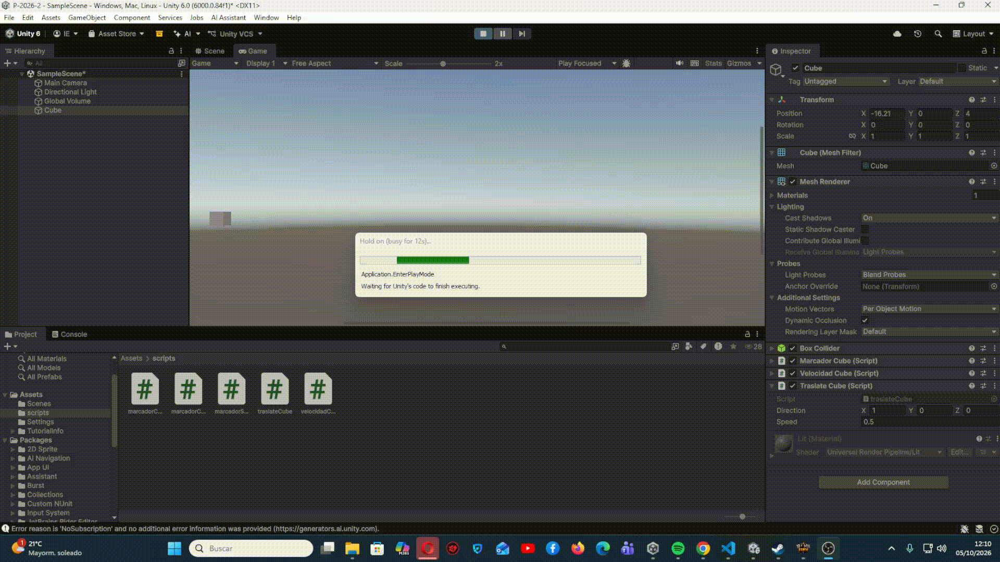

### Altura mayor a 0

La velocidad es la normal no se ve alterada

### Intercambiar moviumiento relativo y movimiento mundial

En este apartado podemos ver como si se utiliza el `Space.World` como parámetro final en la función del Translate el objeto en vez de moverse en referencia a como este está rotado se mueve según las coordenadas mundial de Unity aquí veremos la diferencia:

- Utilizando `Space.Self`
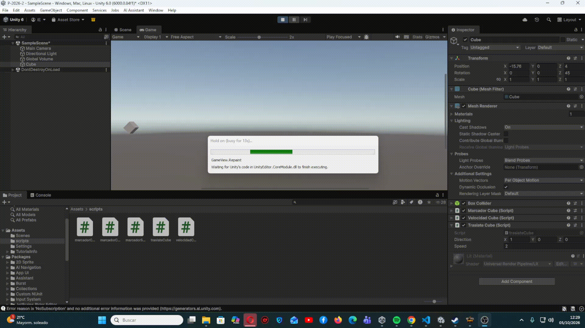

- Utilizando `Space.World`
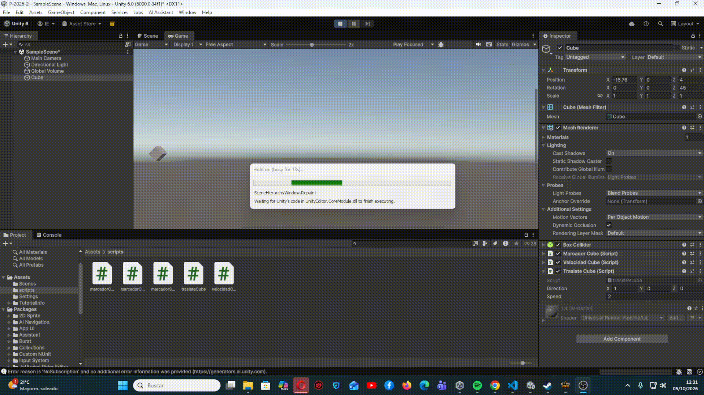

## Ejercicio 9: Movimiento con flechas y WASD

Este este ejercicio se busca que cada vez que se detecte en una iteración una de estas teclas se mueva el cubo o la esfera hacia la posición indicada dependiendo de si se pulsaba las flechas del teclado (haciendo que se moviese el cubo) o las tyeclas WASD (haciendo que se moviese la esfera) para esto se hizo que se moviese en horizontal o en vertical cada uno de ellos usando las funciones de `Input.GetKey(KeyCode.)`.

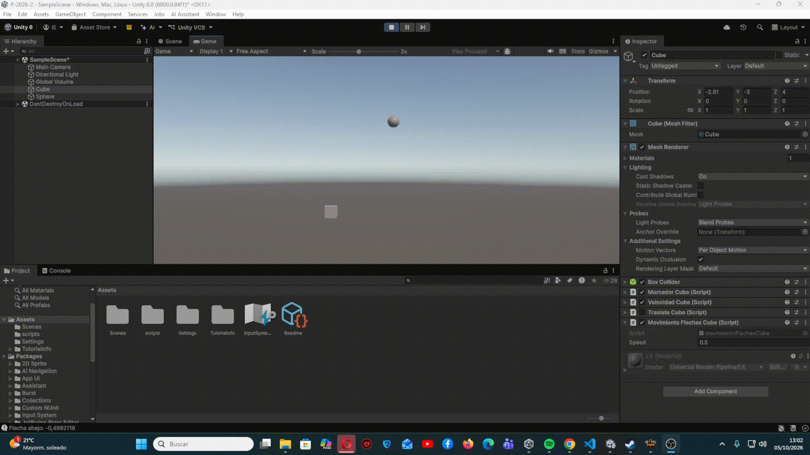

## Ejercicio 10: Uso del DeltaTime

En este ejercicio se pidió modificar el script para que el movimiento se sucediese con una velocidad que fuese acorde con el tiempo e independiente a los FPS así utilizamos una función perteneciente a la clase `Time` llamada `Time.deltaTime` la cual se multiplicará a la velocidad proporcionada por el usuario.

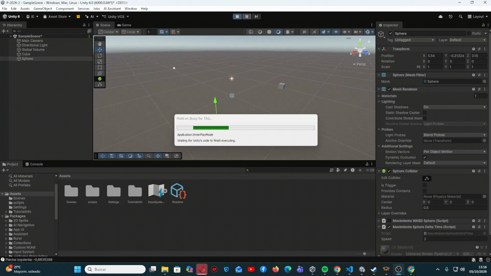

## Ejercicio 11: Mover Cubo hacia Esfera

Para este ejercicio se proponía juntar el cubo con una esfera para ello se calculaba la distancia entre las posiciones de los dos objetos y para que la velocidad no se viese afectada debido a la distancia que se ve entre los dos objetos se normaliza el vector de dirección utilizando para ello una función `direction.normalized` además de hacer que la altura del cubo no se modifique utilizando para ello un `direction.y = 0`. 

Finalmente unimos los dos objetos utiizando el Translate utilizando tanto la velocidad como la dirección obtenida y el deltaTime.

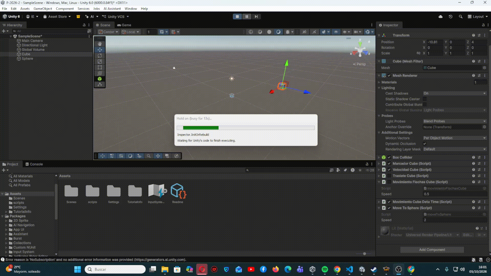

## Ejercicio 12: Movimiento con LookAt

Para poder continuar con este ejercicio se nos propuso la utilización de la función `tranform.LookAt()` la cual se encargaba de hacer que el cubo mirase haci el objetivo en este caso la esfera.

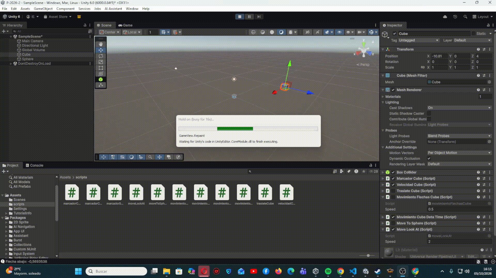

## Ejercicio 13: Rotación horizontal

En este último ejercicio se nos pidió que se incluyera una opción donde mediante las teclas de izquierda y dercha pudiesemos rotar el cubo hacia esos lados utilizando para ello un `GetAxis("Horizontal")` un `transform.Rotate(0, horizontal, 0);` para que se gire en horizontal solamente y en la función Translate añadiendo un `transform.forward` para que solo avance en el eje Z y poniendo al final de la función `Space.World` ya el forward actua sobre los ejes globales.

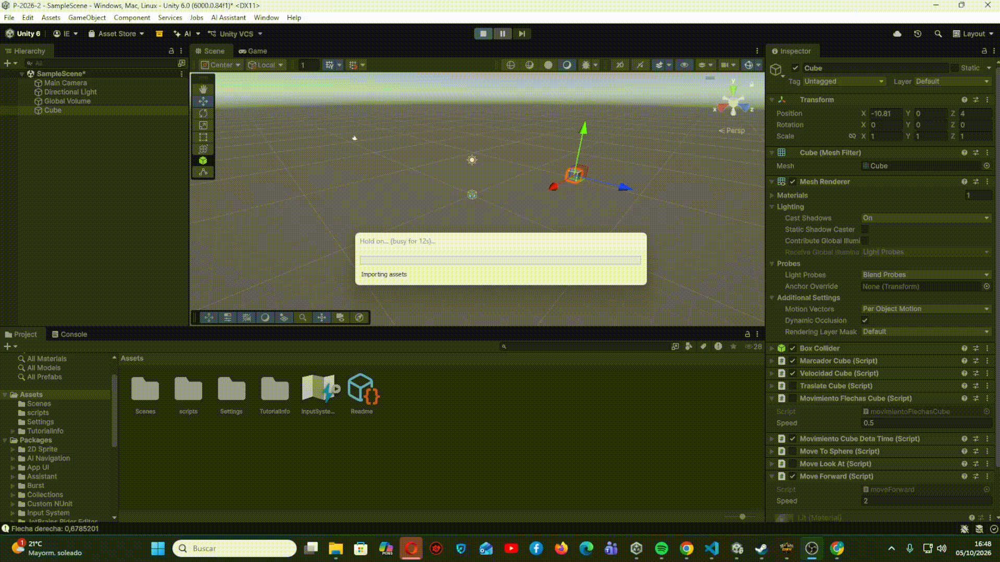